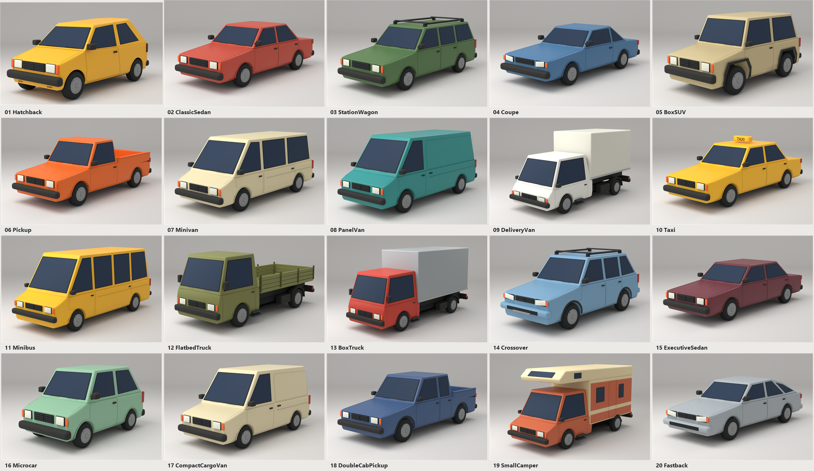

# Индивидуальные модели транспорта

20 самостоятельных файлов Blender: ранее одобренный хэтчбек №01 и 19 следующих
моделей №02–20. Каждый файл содержит одну машину, отдельные коллекции кузова,
стёкол, колёс и деталей, а также студию и упакованный фрагмент референса.

## Каталог файлов

| № | Машина | Файл Blender |
| --- | --- | --- |
| 01 | Хэтчбек — одобренная версия без изменений | [01_Hatchback](01_Hatchback/01_Hatchback.blend) |
| 02 | Классический седан | [02_ClassicSedan](02_ClassicSedan/02_ClassicSedan.blend) |
| 03 | Универсал с багажником на крыше | [03_StationWagon](03_StationWagon/03_StationWagon.blend) |
| 04 | Купе | [04_Coupe](04_Coupe/04_Coupe.blend) |
| 05 | Угловатый внедорожник с запаской | [05_BoxSUV](05_BoxSUV/05_BoxSUV.blend) |
| 06 | Пикап с одинарной кабиной | [06_Pickup](06_Pickup/06_Pickup.blend) |
| 07 | Пассажирский минивэн | [07_Minivan](07_Minivan/07_Minivan.blend) |
| 08 | Грузовой фургон | [08_PanelVan](08_PanelVan/08_PanelVan.blend) |
| 09 | Развозной фургон с отдельной будкой | [09_DeliveryVan](09_DeliveryVan/09_DeliveryVan.blend) |
| 10 | Такси | [10_Taxi](10_Taxi/10_Taxi.blend) |
| 11 | Микроавтобус | [11_Minibus](11_Minibus/11_Minibus.blend) |
| 12 | Бортовой грузовик | [12_FlatbedTruck](12_FlatbedTruck/12_FlatbedTruck.blend) |
| 13 | Грузовик с закрытым кузовом | [13_BoxTruck](13_BoxTruck/13_BoxTruck.blend) |
| 14 | Кроссовер | [14_Crossover](14_Crossover/14_Crossover.blend) |
| 15 | Большой седан | [15_ExecutiveSedan](15_ExecutiveSedan/15_ExecutiveSedan.blend) |
| 16 | Микролитражка | [16_Microcar](16_Microcar/16_Microcar.blend) |
| 17 | Компактный грузовой фургон | [17_CompactCargoVan](17_CompactCargoVan/17_CompactCargoVan.blend) |
| 18 | Пикап с двойной кабиной | [18_DoubleCabPickup](18_DoubleCabPickup/18_DoubleCabPickup.blend) |
| 19 | Небольшой кемпер | [19_SmallCamper](19_SmallCamper/19_SmallCamper.blend) |
| 20 | Фастбек | [20_Fastback](20_Fastback/20_Fastback.blend) |

Обзор всей коллекции и сравнения с референсами: `Docs/VehicleStages/`.
Для каждой новой модели там находятся `Reference.png`, `Front.png`, `Rear.png`,
`Side.png` и `verification.json` с хешем проверенного файла.

## Редактирование и материалы

Единицы — метры, перед машины — +Y, вертикаль — +Z. Четыре ходовых колеса
имеют собственные центры вращения; передняя ось отмечена для будущего поворота.
Кузова и раскладка окон заданы отдельно по каждому силуэту. Шины, обода,
колпаки, крепёж и вентили используют геометрию одобренной модели №01.
Углы панелей скруглены; оптика — отдельные выпуклые объёмы.

Окна непрозрачные: салон не требуется и не просматривается. Четыре UV-карты
512×512 встроены в каждый файл: шероховатость краски, микрофактура резины,
рифление линз и рельеф протектора. Внешние картинки для открытия не нужны.
Коллекции `00_Reference` и `90_Studio` не являются частью машины.

Видимые силуэты построены по согласованному листу `TrafficFleetConcept-v2.png`.
Стороны, отсутствующие на исходном изображении, продолжают тот же стиль;
пиксельное совпадение всех сторон по одному ракурсу не заявляется.

## Проверка и воспроизведение

Путь подготовки: индивидуальное описание формы → сборка одной машины →
сохранение отдельного `.blend` → новый процесс Blender открывает этот файл →
проверки геометрии и материалов → передний, задний и боковой рендеры.

Сценарии:

- `Scripts/Blender/IndividualVehicleDesigns.py` — отдельные профили кузовов и окон.
- `Scripts/Blender/IndividualVehicleCraft.py` — операции моделирования и детали.
- `Scripts/Blender/BuildIndividualVehicle.py` — построение одного файла.
- `Scripts/Blender/VerifyIndividualVehicle.py` — повторное открытие и проверка.
- `Scripts/Blender/TestIndividualVehicleDesigns.py` — тесты размеров и раскладки окон.
- `Scripts/BuildIndividualVehicles.ps1` — последовательное выполнение по машинам.
- `Scripts/BuildIndividualVehicleReview.ps1` — листы просмотра из рендеров Blender.
- `Scripts/Tests/IndividualVehicleFilesTests.ps1` — итоговая сверка файлов и отчётов.

Проверка 17 октября 2026: 19 новых файлов повторно открыты в Blender 5.2.2,
получены 57 ракурсов. Проверены четыре независимых колеса и замкнутость их
деталей, отсутствие вырожденных треугольников, UV, встроенные карты и
непрозрачность стёкол. Для грузовых машин дополнительно проверен зазор
между подножками и передними шинами, а также наличие крепления фонарей.
Все хеши файлов совпадают с отчётами; SHA-256 одобренного хэтчбека не изменился.
Три теста описаний форм, размеров и положения окон также проходят.

Новые источники содержат от 26 902 до 32 896 треугольников после вычисления
модификаторов. Колёса и мелкие скругления составляют значительную часть;
это нужно учитывать при подготовке облегчённых игровых вариантов.

Существующий `.blend` не перезаписывается при обычной сборке. Повторная
проверка не сохраняет сцену и не меняет модель. Промежуточные исправленные
версии сохранены в `Library/IndividualVehiclePipeline/Revisions/`.

## Игровая интеграция

Эти файлы остаются детальными редактируемыми исходниками в low-poly стилистике.
17 октября 2026 отдельно подготовлены и установлены их игровые версии:
`Assets/Art/TrafficFleet/Prefabs`. В префабах три уровня детализации, четыре
поворотных колеса, коллизии и общий текстурированный материал URP.
Тонкие стёкла защищены от удаления в дальних моделях и остаются непрозрачными.
Исходные `.blend` при экспорте и установке не изменялись.

Машины подключены к существующему трафику City/Game. Геометрия карты, сцены
и дорожная сеть не пересоздавались. Подробности, результаты проверки и
ограничения: `Docs/IndividualTraffic.md`. Прежние установленные ассеты
сохранены в `Library/IndividualTrafficImport/BeforeApply_20261017-124521`.
