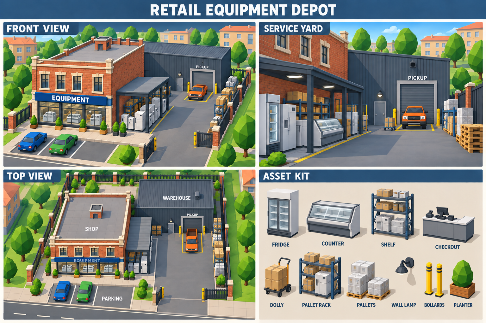

# Магазин торгового оборудования — арт-план

Артём, концепт сохраняет архитектуру референса: кирпичный двухэтажный магазин, кремовые обрамления, синий пояс EQUIPMENT, графитовый склад и боковой навес.

## Зоны

- Фасад: витрины с торговым оборудованием, вход с тротуара, три парковочных места (одно свободное).
- Боковой навес: холодильные витрины, стеллажи и подготовленные товары; экспозиция вдоль стены, не поперёк проезда.
- Склад: широкие ворота PICKUP, отдельная свободная дверь персонала, площадка для погрузки. Пикап показан грузовой частью к воротам.
- Двор: ориентировочно шестиметровый боковой проезд, отдельное место ожидания/маневрирования, тележка, паллеты и коробки по краям.
- Периметр: открытый въезд, ограждение с кирпичными столбами, небольшие кашпо внутри участка.

## Набор моделей

Основные корпуса, навес, роллетные ворота, входная дверь, витринные окна, вывеска; холодильный шкаф, холодильная витрина, товарный стеллаж, кассовая стойка с терминалом, грузовая тележка, паллетный стеллаж, паллеты с упакованным оборудованием, настенные светильники, защитные столбики, кашпо и секции забора.

## Порядок реализации

1. Определить участок и реальные размеры. На серых простых объёмах проверить парковку, въезд, движение и задний заезд игрового пикапа к выдаче.
2. Собрать кирпичный магазин, склад и навес; закрыть стыки стен и непрерывный парапет.
3. Создать витрины, вход и англоязычные вывески.
4. Добавить оборудование и модульные детали из набора, оставляя двери и манёвренную площадку свободными.
5. Разместить ограждение, небольшие посадки и освещение; кашпо не пересекают забор, мебель не висит над полом.
6. Сохранить существующее взаимодействие поставщика Equipment и проверить коллайдеры, заезды, размеры зоны загрузки и окружающий город.

## Ограничения концепта

Картинка — визуальный ориентир, не точный чертёж и не готовая 3D-модель. Верхний ракурс схематический: размеры проезда, поворот автомобиля, позиции дверей и пропорции нужно проверять в Unity на выбранном участке. Декор и мелкие архитектурные детали между ракурсами могут отличаться; для реализации потребуется одна согласованная геометрия. Роли товаров выбраны по существующему SupplierKind.Equipment: торговое оборудование, не бытовая прачечная техника. Сцена и текущие здания этим запросом не изменялись.

Генерация: встроенный image_gen, навык imagegen. Англоязычные промпты сохранены в EquipmentPlan-v1-prompts.md.

