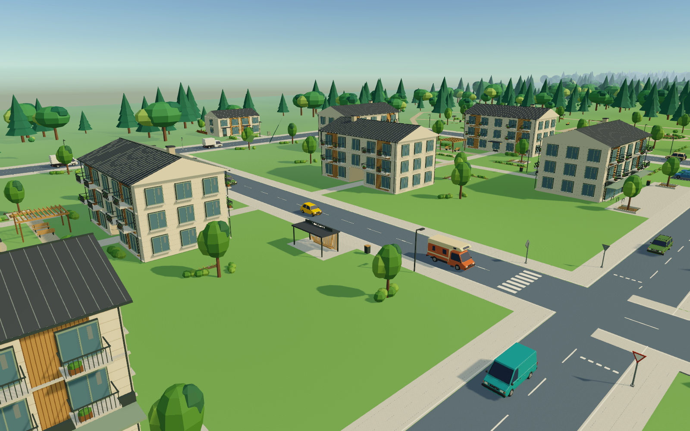

# Трафик из индивидуальных моделей

Установлено 17 октября 2026. Пройдены Build, повторное открытие Review и
два реальных прогона Play Mode, второй — после сохранения параллельного
косметического изменения версии игры на `v0.14`. В основном проекте эта
строка не редактировалась установщиком.

Принятые 20 отдельных исходников из `ArtSource/TrafficVehicles` заменяют прежнюю
серию в существующем дорожном трафике. GUID префабов и идентификаторы компонентов
`TrafficVehicle` сохранены: общий городской префаб и обе сцены продолжают
ссылаться на те же ассеты. Перестраивать город или сохранять открытую сцену
для замены моделей не требуется.

## Как появляется движение

Положение игрока/камеры → ячейка 96×96 м → точки появления на общественных
дорогах в текущей и восьми соседних ячейках → ограниченный пул до 48 машин →
движение по существующей сети из 150 направленных полос → поворот и вращение
четырёх колёс. Сеть охватывает город, северный район, сельскую дорогу и ферму.
При удалении от игрока машины возвращаются в пул. Непрерывная симуляция
всех автомобилей на всей карте не добавлялась.

Используются существующие остановки на светофорах, резервирование перекрёстка,
дистанция до впереди идущей машины, физические препятствия, профиль мостов и
защита железнодорожного переезда. Размер зоны проверки свободного места перед
появлением теперь вычисляется по наиболее крупной машине принятой серии,
а не задаётся фиксированным размером прежних кузовов.

## Графика и производительность

В каждом префабе четыре самостоятельных центра вращения колёс и три LOD —
уровня детализации, которые Unity выбирает по размеру машины на экране.
Вдали остаётся менее 20% исходных треугольников; у самого дальнего уровня
отключена отбрасываемая тень. На каждом уровне пять отображаемых мешей:
кузов и четыре колеса. Оригинальные редактируемые `.blend` не изменены.

Все машины используют один непрозрачный материал URP Lit и три общие
карты 2048×2048: цвет, металличность/гладкость и нормали для рельефа.
Цвета и свойства поверхностей извлечены из отдельных исходников Blender.
Это приближение их узлов материалов для URP, не обещание идентичного
освещения Cycles. Стёкла остаются тёмными и полностью непрозрачными.

Плоские стёкла и уплотнители экспортируются с обеими сторонами, поскольку
Blender отображает исходные плоскости двусторонними, а Unity обычно отсекает
обратную сторону. При упрощении они защищены от удаления. Нативная проверка
сравнивает количество треугольников стекла между всеми LOD каждой машины.
Отключать отсечение обратных граней у всего кузова не потребовалось.

## Подготовка и проверка

- `Scripts/Blender/ExportIndividualTraffic.py` читает один сохранённый `.blend`,
  вычисляет модификаторы, переносит UV/нормали, объединяет детали по кузову
  и колёсам, создаёт дистанционные версии и экспортирует FBX. Режим `--atlas`
  собирает общие карты из описаний всех двадцати экспортов.
- `Assets/Project/Editor/IndividualTrafficBatch.cs` импортирует FBX в отдельной
  копии Unity, собирает префабы, проверяет их сохранённые идентификаторы,
  масштабы, направление фар, UV, материал, колёса, LOD и ссылки City/Game.
- `Scripts/InstallIndividualTraffic.ps1` выполняет Prepare/Sync → Build → Review
  → Play → Apply. Review открывает сохранённые ассеты в новом процессе Unity.
  Перед Apply проверяются квитанции проверок, неизменность исходников,
  сцен, дорог и остальных ассетов основного проекта. Заменяемые ассеты
  предварительно копируются в `Library/IndividualTrafficImport/BeforeApply_*`.
- `Scripts/Tests/IndividualTrafficPipelineTests.ps1 -Installed` сверяет исходники,
  экспорт, прозрачность атласа и установленные байты ассетов с результатом
  нативной проверки Unity.

Результаты находятся в `Docs/IndividualTrafficReview`: отчёты Build/Review,
настоящий Play Mode, пять районных прогонов, остановка перед красным и
препятствием, движение по мосту и взаимодействие с переездом. Успех
подтверждается только файлами со статусом `PASS`, не наличием документа.
Изображения — кадры Unity, включая сохранённые City и Game, не концепт-арт.

Подтверждено восемь секунд обычного Play Mode и пять ускоренных прогонов
по 30 игровых секунд с нативной физикой. Все 20 вариантов участвовали;
центр, восток и север — по 48 активных машин, сельская дорога — 26,
ферма — 20. Пул не превысил 48. Проверены завершённые повороты,
вращение/руление колёс, выборочные пересечения коллайдеров, удержание
на красном без сползания, остановка перед препятствием и продолжение
после его удаления, подъём/спуск по мосту и защита занятого NPC переезда.

Перед заменой сохранена копия прежних ассетов:
`Library/IndividualTrafficImport/BeforeApply_20261017-124521`.
Файлы сцен City/Game, общий городской префаб и RoadNetwork сохранили
исходные хеши. Исходники двадцати моделей Blender также не изменены.

## Ограничения

NPC следуют заданным дорогам; это не физическая подвеска автомобиля игрока.
Обгоны, смена полос, парковка во дворах, посещение поставщиков и повреждения
не добавлялись. Статические припаркованные автомобили окружения не заменялись.
FPS на целевых устройствах не измерялся. Настройки карты, поезд, участки,
магазин и пользовательское сохранение не являются выходными файлами установки.
